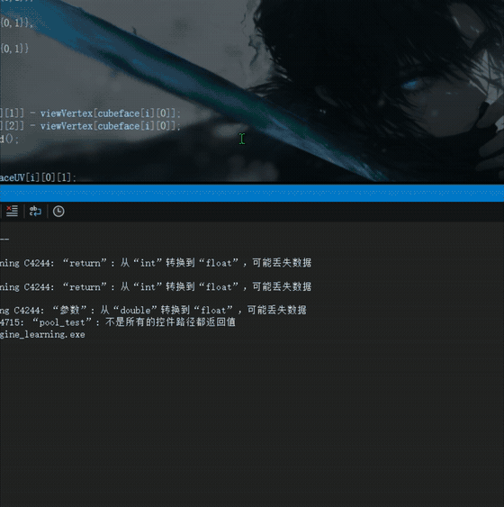
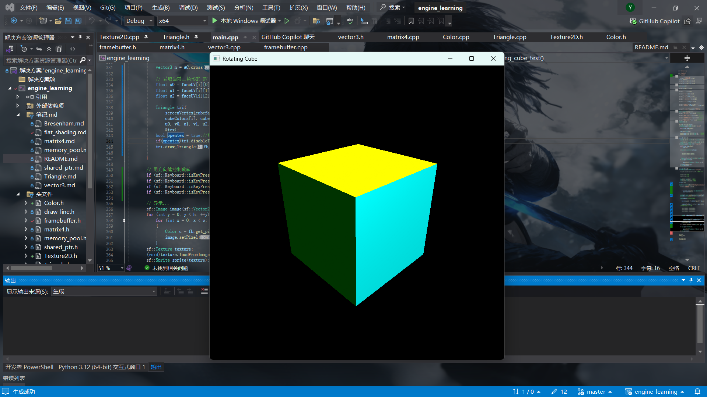
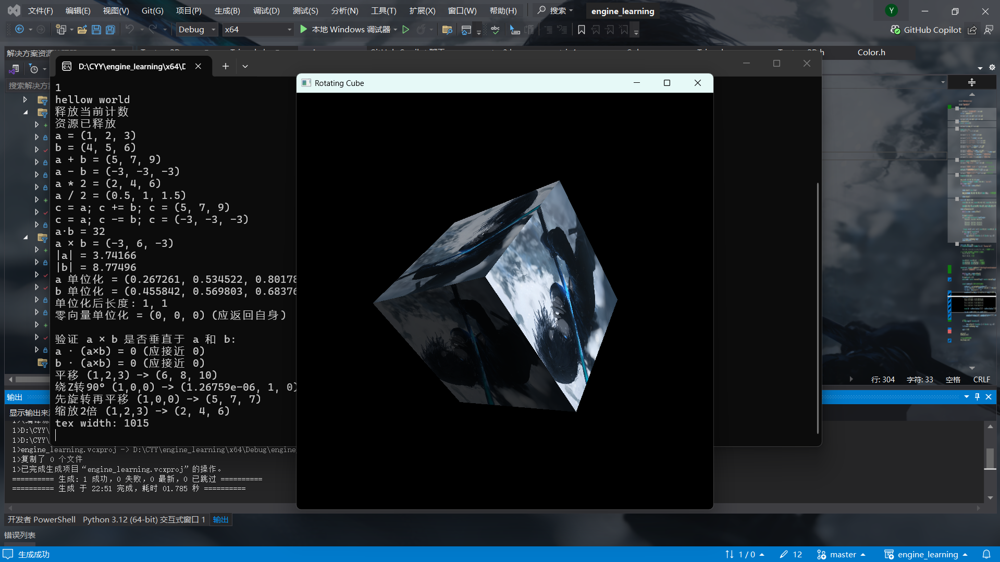
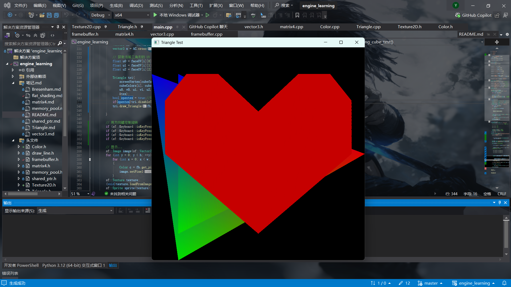
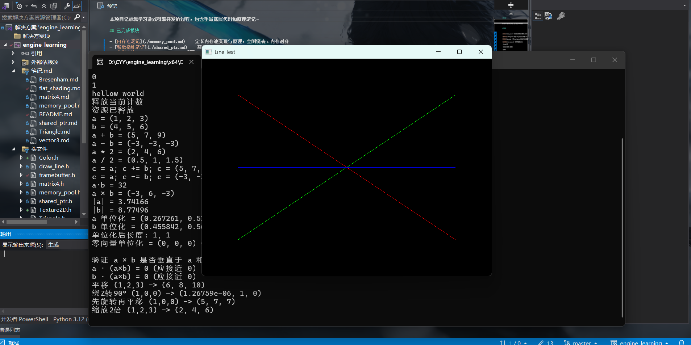

# SoftRenderer — 手写 3D 软件光栅化渲染器

C++17 实现的软件渲染器，**不使用任何图形 API**。SFML 仅用于窗口创建、图像加载与像素显示。



[完整演示视频（25 秒）](engine_learning/demo.mp4)

## 已实现模块

- **定长内存池** — 空闲链表管理、内存对齐（[笔记](engine_learning/memory_pool.md)）
- **简化版智能指针** — 引用计数、RAII、自赋值检测（[笔记](engine_learning/shared_ptr.md)）
- **手写数学库** — `Vector3` / `Matrix4`，MVP 变换、透视投影、矩阵求逆（[笔记](engine_learning/matrix4.md)）
- **软件光栅化渲染器**：
  - Bresenham 画线（整数增量算法）
  - 重心坐标三角形填充 + 深度缓冲 + 背面剔除（有向面积符号判定）
  - **透视校正纹理映射**：UV 按 1/z 加权插值再归一化，消除透视拉伸
  - **Blinn-Phong 光照**：环境光 + 漫反射 + 半程向量高光
  - **Mipmap 纹理**：金字塔生成、双线性采样、三线性过滤，
    LOD 由屏幕空间 UV 梯度（texel/pixel 比）自动计算
  - 键盘交互（旋转 / 缩放）

| Blinn-Phong 光照 | Mipmap 纹理 |
|---|---|
|  |  |

| 深度缓冲 | Bresenham 画线 |
|---|---|
|  |  |

## 关键实现

**1. 透视校正：UV 不能在屏幕空间直接线性插值**

在屏幕空间对 UV 线性插值，透视投影下会明显拉伸。正确做法是把 u/z、v/z 和 1/z
一起插值，最后再除一次：`u = (u/z 插值结果) / (1/z 插值结果)`。这一步做完，近大远小才正确。

**2. Mipmap 的 LOD 是算出来的，不是按距离猜的**

LOD 由「屏幕走 1 像素时 UV 走多远」决定：对透视校正后的 UV 求偏导，乘以纹理尺寸得到
texel/pixel 比，取 log2 就是层级。一个三角形内该梯度近似为常数，所以每个三角形只算一次，
主循环里直接使用。这样远处的三角形自动落到低分辨率层，摩尔纹消失。

**3. 修过一个潜伏两个月的溢出 bug**

接上 LOD 后画面立刻变成一片混浊。原因是 `Color::operator+` 里
`unsigned char + unsigned char` 会提升为 int 再截断回 unsigned char，255+255 直接回绕；
而 Mipmap 降采样是 `(c00+c01+c10+c11)/4`，三次相加就溢出了。
之前 LOD 写死 0、mip 层从未被采样，所以这个 bug 一直没暴露。

## 操作

| 按键 | 功能 |
|---|---|
| ← / → | 水平旋转模型 |
| ↑ / ↓ | 垂直旋转模型 |
| 鼠标滚轮 | 缩放 |

## 技术栈

- C++17
- 手动内存管理、定长内存池、智能指针、虚函数表
- 图形学：MVP 变换、透视投影、光栅化、深度缓冲、背面剔除、Blinn-Phong 光照
- 纹理系统：Mipmap 生成、双线性 / 三线性采样、透视校正插值
- 第三方库：SFML 3.0.2（窗口管理、图像加载、像素操作）

## 项目结构

```
engine_learning/            # 源码（Visual Studio 工程）
├── main.cpp                # 场景组装与键盘交互
├── Triangle.cpp            # 光栅化 + 光照 + 纹理采样 + LOD 计算
├── Texture2D.cpp           # Mipmap 生成、双线性/三线性采样
├── framebuffer.cpp         # 帧缓冲 + 深度缓冲
├── matrix4.cpp / vector3.cpp  # 手写数学库
├── memory_pool.cpp         # 定长内存池
├── shared_ptr.h            # 简化版智能指针
└── draw_line.cpp           # Bresenham 画线
```

## 说明

- 第三方依赖 SFML 3.0.2（仅用于窗口与图像加载），未入库
