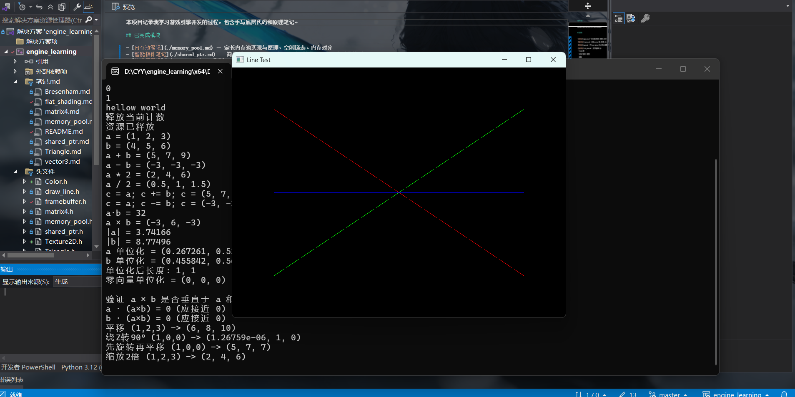
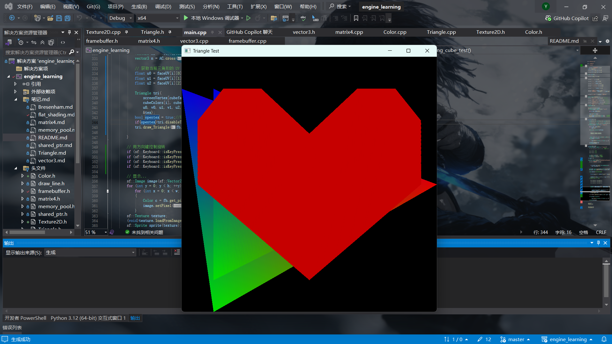
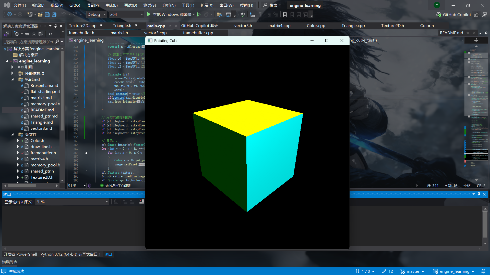
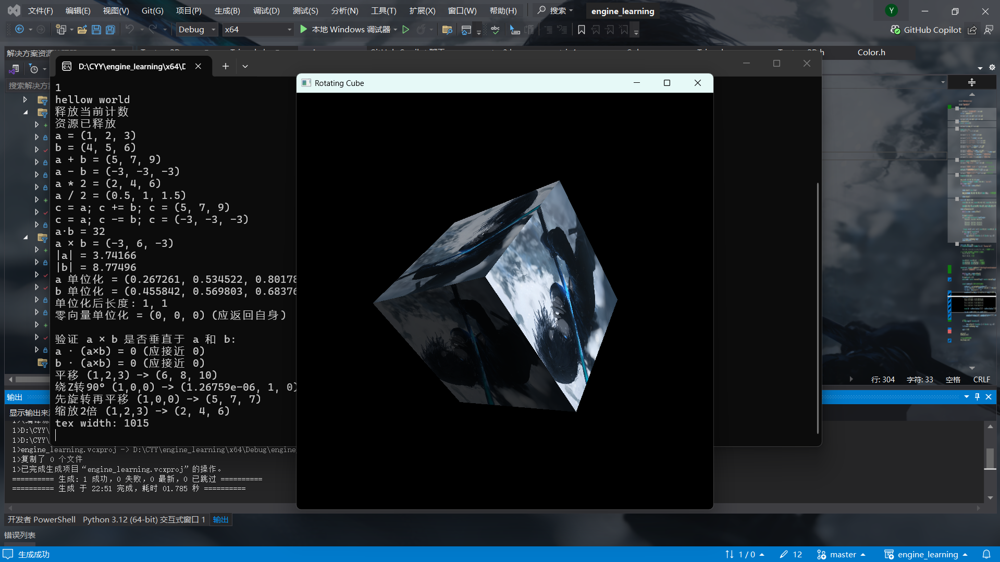

# SoftRenderer — 手写 3D 软件光栅化渲染器

C++17 实现的软件渲染器，**不使用任何图形 API**。SFML 仅用于窗口创建、图像加载与像素显示。

## 已实现模块

- **定长内存池** — 空闲链表管理、内存对齐（[笔记](./memory_pool.md)）
- **简化版智能指针** — 引用计数、RAII、自赋值检测（[笔记](./shared_ptr.md)）
- **手写数学库** — `Vector3` / `Matrix4`，MVP 变换、透视投影、矩阵求逆（[笔记](./matrix4.md)）
- **软件光栅化渲染器**：
  - Bresenham 画线

    

  - 重心坐标三角形填充 + 深度缓冲 + 背面剔除（有向面积判定）
  - 透视校正纹理映射（UV 按 1/z 加权插值）

    

  - Blinn-Phong 光照（环境光 + 漫反射 + 半程向量高光）

    

  - Mipmap 金字塔生成、双线性 / 三线性采样

    

  - 键盘交互（旋转 / 缩放）

## 技术栈

- C++17
- 手动内存管理、定长内存池、智能指针、虚函数表
- 图形学：MVP 变换、透视投影、光栅化、深度缓冲、背面剔除、Blinn-Phong 光照
- 纹理系统：Mipmap 生成、双线性 / 三线性采样、透视校正插值
- 第三方库：SFML 3.0.2（窗口管理、图像加载、像素操作）
